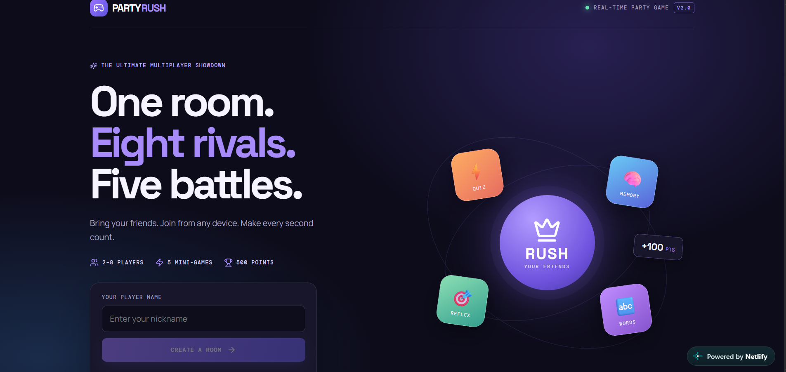
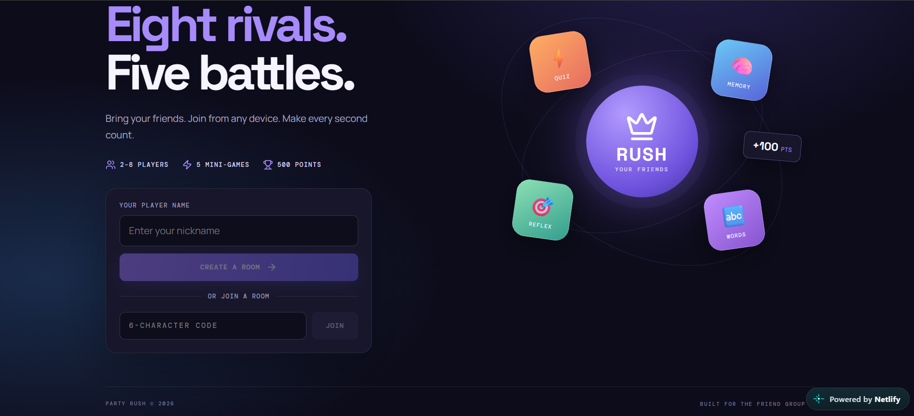
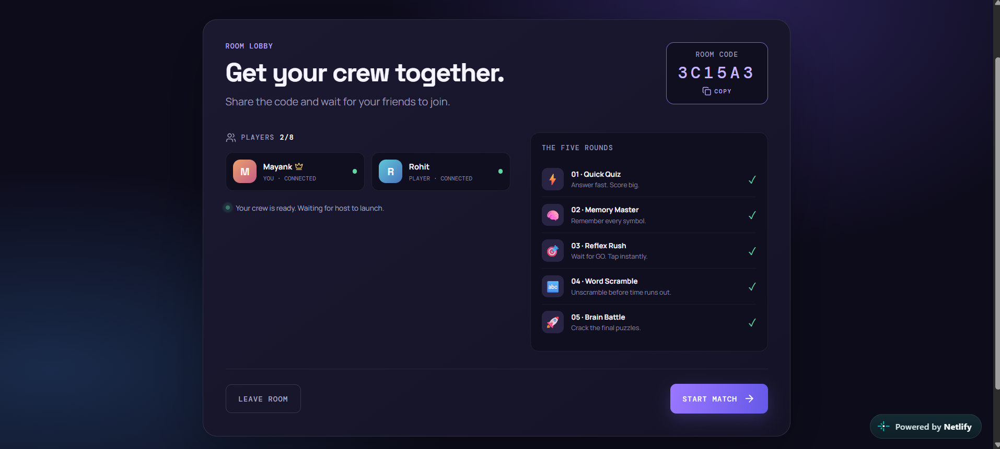

<div align="center">

# 🎮 PARTY RUSH

### One room. Eight rivals. Five battles.

A real-time multiplayer party game where friends join with a room code and compete across five mini-games.

[**Play Party Rush**](https://play-party-rush.netlify.app)


</div>

---

## ✨ About the game

Party Rush brings a friend group together in one multiplayer room. The host creates a room, shares a six-character code, and starts a five-round match when everyone is ready.

- **2–8 players** can join a room.
- **Five mini-games** test speed, memory, knowledge, and word skills.
- **500 points** are available across the five rounds.
- A leaderboard appears after every round, with a final winner at the end.

## 🕹️ Mini-games

| Game | Challenge |
|---|---|
| ⚡ Quick Quiz | Answer fast and score big |
| 🧠 Memory Master | Remember every symbol |
| 🎯 Reflex Rush | Wait for GO and tap instantly |
| 🔤 Word Scramble | Unscramble before time runs out |
| 🚀 Brain Battle | Crack the final puzzles |

## 📸 Screenshots

### Home screen


### Home screen — alternate view


### Multiplayer room lobby


## 🧰 Tech stack

- **Frontend:** React 18, Vite
- **Icons:** Lucide React
- **Serverless backend:** Netlify Functions
- **Persistent room storage:** Netlify Blobs
- **Testing:** Node.js test runner

## 🚀 Run locally

**Requirements:** Node.js `>=22.12.0` and npm.

```bash
npm install
npm run dev
```

To create a production build:

```bash
npm run build
```

## ☁️ Deployment

This project is configured for Netlify. The `netlify.toml` file defines the build command, publish directory, and Functions directory.

Deploy the project through Netlify with the repository connected, or use Netlify Drop with the complete project folder. Do not deploy only the `dist` folder: the multiplayer game also needs its Netlify Function.

## 🧪 Tests

Run the automated tests with:

```bash
npm test
```

## 📁 Project structure

```text
.
├── client/                 # React frontend
├── netlify/
│   ├── functions/          # Netlify serverless function
│   └── lib/                # Game and room logic
├── screenshots/            # Actual Party Rush screenshots
├── tests/                  # Automated tests
├── netlify.toml
├── package.json
└── README.md
```

## 👨‍💻 Built for the friend group

Made to bring friends together, wherever they are.

---

<div align="center">

**[Play Party Rush](https://play-party-rush.netlify.app)** · **[View source on GitHub](https://github.com/mayank-d-tech/party-rush)**

</div>
